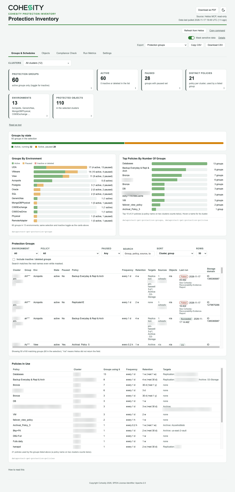

Copyright Cohesity 2026, SPDX-License-Identifier: Apache-2.0

# Cohesity Protection Inventory

**Author:** Akshay Kumar, Dir, Solutions Architecture ([akshay.kumar2@cohesity.com](mailto:akshay.kumar2@cohesity.com))

A Claude skill that lists what is protected by what, from live Helios data, and publishes it as a live, private Claude Artifact. The refresh schedule is set in the page's Settings tab. It is an inventory and lookup page with no verdicts: coverage percentages, policy pass / warn / fail, exceptions, source-registration health and double-protection findings stay in **Cohesity-Protection-Coverage-Audit**.

- Claude skill: [`claude/Cohesity-Protection-Inventory/SKILL.md`](claude/Cohesity-Protection-Inventory/SKILL.md) (the full page template is embedded in it)
- Output: one claude.ai **Artifact** titled `Cohesity Protection Inventory` (no static HTML file)
- Refresh: manual by default (the **Refresh from Helios** link opens a new Claude chat with the command typed in; press Enter there to run it; **Copy command** copies the same text). To schedule it, use the **Refresh schedule** card in the page's Settings tab (frequency, day, time, time zone, or off) and save; the skill converts the requested time to the local time of the computer running Claude. The skill never asks about scheduling in chat. When the saved request is not applied yet, the card says "Not applied yet. Click Apply in Claude" and offers an **Apply in Claude** link that opens a Claude chat with the apply command. The links need the Cohesity-Protection-Inventory skill and the Helios connector in the viewer's Claude, and the buttons are disabled for viewers who are not signed in to Claude (for example public-link viewers). At the start of every run it reads your saved request, creates or updates the scheduled task `cohesity-protection-inventory-refresh` to match (turning it off disables the task, it is never deleted), and records the schedule it found in Claude's scheduler on the page. So the card shows what the skill saw at its last run, and a change made in Claude Desktop or on the web appears there after the next run; until you apply it a saved request shows as "Not applied yet". Asking Claude to "apply the saved schedule" runs the schedule-only mode: no Helios calls, only the scheduled task and the schedule fields of the page change. Scheduled runs need Claude open on that computer (scheduled tasks may be moved to the cloud later). The page mentions a refresh schedule ("Refreshes daily at 9 AM") only when an enabled one exists.
- Data source: the **Helios MCP server**. Everything is read-only. This skill does not use Cohesity AI agents.

## Sample output



Screenshots of every tab, with lab data and names blurred, are in [claude/README.md](claude/README.md).

## Tabs

| Tab | What it shows | Helios MCP tools |
|---|---|---|
| Groups & Schedules (main) | One row per protection group: cluster, environment, state, paused, policy, backup frequency, retention, replication and archival targets, source count and up to 4 source names, protected object count, last run status and time, storage domain. Toggle for inactive or deleted groups. Filters (environment, policy, paused, search), sort, KPI cards (groups, active, paused, distinct policies, environments) and a plain "Policies in use" table. | `dataprotect-get-protection-groups`, `dataprotect-get-protection-policies`, `dataprotect-get-source-registrations` |
| Objects | Protected-by lookup over the embedded object table, environment breakdown, and a table of protected objects (name, environment, type, cluster, protecting groups, policy, last run status, global object id). | `dataprotect-search-objects` |
| Compliance Check | Scan of every string the page shows (including object names) for PII, PHI and other sensitive data, with a mask switch. | none (client-side) |
| Run Metrics | Helios calls, time, estimated tokens and cost per run, a Tool availability list (every Helios tool the skill can use, with its status and the real reason when one is missing, disabled or not licensed), per-tool call timing and errors, month to date, projection, run history with an **Audit trail** button (a pop-up of every Helios call and decision of each run, with Category, Status and Run filters, search and a CSV download), and a **Pricing source** card: an editable link (default Anthropic's public pricing page `https://platform.claude.com/docs/en/about-claude/pricing`; an editor can save another page, CSV or Excel link with a negotiated rate, kept in the page database as `settings/pricing`) where the skill looks up the price per million input tokens; the skill only reads it, and a source it cannot read falls back to the default and says so. | none |
| Settings | The canonical Settings block (v1.4) shared by all six Cohesity skills: a table of how this page uses your data with one row, "Data tools" (always on, greyed switch): the tools used and whether they were used in the last run. The **Refresh schedule** card below the table shows the schedule the skill saw at its last run and lets an editor save a schedule request (frequency, day, time, **time zone**, or off) in the page database; the time zone defaults to the viewer's own zone, and the skill converts the requested time to the local time of the computer that runs Claude (daylight saving changes can shift the local run time by one hour). Each row becomes a stacked card on narrow screens. | page database and viewer identity, for the schedule card only |

**The first tab is a set of widgets:** a hero tile (Protection groups) and tiles for Active, Paused, Distinct policies, Environments and Protected objects, each with a small trend line once three or more runs are recorded (the data JSON keeps up to 30 points, one per run) and a change chip against the previous run, a segmented bar of groups by state, and two charts (groups by environment as a stacked bar of active, paused and inactive or deleted, and the top 10 policies by number of groups). The three-sentence **Summary** is kept as text behind a "Read as text" toggle (and shown as a card in the PDF), and long notes sit in closed "How to read this" blocks. A **Download as PDF** button builds one real PDF in the browser from the data already on the page (nothing is sent anywhere): the header and summary on the first page, then a section for every report tab (Groups & Schedules, Objects, Compliance Check, Run Metrics; never Settings), each starting on a new page with a header band, tables capped at 500 rows ("First 500 of N rows. Use Download CSV for all rows."), at most 150 pages, and a footer with title, time, tab name and page numbers. It uses html2canvas and jsPDF loaded from cdnjs.cloudflare.com on first click and saves through the downloads capability, which asks you to confirm. When a figure had to be typed in by hand from inline tool output, a footnote says so (`meter.manual`). A failed last run shows the muted hint "See Cohesity-Recoverability-Evidence-Report" and an unknown policy shows "See Cohesity-Protection-Coverage-Audit"; the owner can turn these into links by putting https URLs in the `SIBLING_URLS` constant at the top of the template script. The mask now also covers 12-digit cloud account ids (for example in a source name such as `210537812178/alta-protection`), AWS ARNs and Azure subscription or tenant ids, and the Compliance Check lists them as Low (Sensitive). Tiles are clickable (a "›" cue; Enter or Space also work): they jump to the matching table, with the Paused filter set for Active and Paused, or open the Objects tab.

A cluster multi-select above the tabs filters every table; the page header carries the Cohesity logo and a "Data last pulled" stamp that turns amber after 36 hours when a refresh schedule exists. A **Refresh from Helios** link (a published page cannot call Helios) opens a new Claude chat with the refresh command typed in and says "Opened Claude with the command. Press Enter there to run it, then reload this page when the run finishes."; a small **Copy command** button copies the command instead. For viewers who are not signed in the link is a disabled button with the reason. The **Mask sensitive data** switch (on by default) masks IP addresses, hostnames, account names in connection strings, emails, SSNs, 12-digit cloud account ids, AWS ARNs, Azure ids and bare GUID source names in the tables and in CSV output, and shortens every protection group name and object name to its first two letters plus `***` (search still matches the real names). Cluster and policy names are shown as they are. Exports (Copy or Download CSV): `groups`, `policies`, `objects`, `environments`, plus Compliance findings, Run history, `tool-calls` and `tool-availability`.

## When a Helios tool is missing, disabled or not licensed

A missing, disabled or unlicensed tool never stops the skill. The page is built from the data that was obtained: the affected KPIs, columns and panels show "n/a" (never 0), a slim pill bar at the top of each affected tab says what is not shown (the Details button holds the full reason) (for example "Disabled or access denied" or "Not licensed or not entitled"), and Run Metrics, Tool availability lists every tool with its status. Only when `dataprotect-get-clusters` itself fails does the skill keep the last page and add an error banner that names the reason.

The page header has ONE icon theme toggle at the top right (a sun when the page is dark, a moon when it is light). The page follows the browser or system light or dark setting and switches live when that setting changes; clicking the button flips the theme for this page view only, and the choice is not stored (it resets when the browser setting changes or the page is reloaded). The button is hidden in print. The footer reads "Copyright Cohesity 2026, SPDX-License-Identifier: Apache-2.0".

## Object table limits

The Objects tab data is pulled on a fresh run. Every run reads the existing page and reuses its stored object rows, environment counts and per-cluster totals while they are less than 20 hours old (scope note: "path: reused objects (as of <time>)"); groups, policies and sources are always fetched fresh, so a reuse run makes only about 2 Helios calls per connected cluster plus the sources call. Ask for a "full refresh" (or when the stored rows are 20 hours old or more, which a daily 9 AM scheduled run always is) to re-pull the objects ("path: fresh"). Reused rows keep their stored last-run status.

The object list can have tens of thousands of rows. The skill reads each cluster's protected object total from its first object page (a separate `count: 1` call is made only when a cluster's cap is below the total), then embeds at most 2000 rows overall (a per-cluster cap proportional to its total, minimum 100, paged 200 at a time with `paginationCookie`, at most 10 pages per cluster). The page states "showing N of M; ask for a lookup in chat for the rest". The rows are the first ones Helios returns, shown alphabetically; they are not a ranked or random sample.

## Chat lookups (no republish)

- "Who protects <object>": object search plus group, policy and last run.
- "What does group <name> protect": the group's policy, sources and objects (object search filtered by group, with a fallback to run details).
- "Global id of <object>": the global object id from the object search.

## Run cost

About 36 Helios calls with 6 connected clusters and 92 groups on a fresh-objects run (clusters 1, groups 1 unfiltered call per cluster, policies 1 per cluster that has groups, registrations only when a group names its source by id, object first page 1 per cluster which also gives the total, about 12 to 16 environment counts, a few more object pages). At most one retry per call (after 30 s), and a cluster whose groups call fails twice is marked partial and gets no further call to the cluster in that run. Large results are processed from files, not read into the conversation. Measured cost is in Claude Settings > Usage.

## Requirements

- Claude desktop app (Cowork) with the **Helios MCP** connector.
- Artifacts available. Scheduled tasks are optional; a schedule you save in the Settings tab runs only while the Claude app is open on that computer.

## Install

1. Zip the folder `claude/Cohesity-Protection-Inventory` so `SKILL.md` is inside it, or install from `github.com/Cohesity-Maestro/Cohesity-Protection-Inventory`.
2. Add it as a custom skill in Claude (Settings, Skills, upload).
3. Confirm the Helios MCP connector is connected.

## Use

- "Run the Cohesity protection inventory"
- "List all protection groups with their policy and schedule"
- "Who protects <server name>?"
- "What does the group <name> protect?"
- "What is the global id of <object>?"

## When Helios is unreachable

When `dataprotect-get-clusters` fails, the run (manual or scheduled) keeps the last successful data and adds a red banner "Unable to read Helios data: <reason>. ... Showing the last successful data." The next successful refresh removes it.

## Known limits

- Object rows are capped (see above); use the chat lookup for the rest.
- Not-connected clusters cannot be queried and show as `n/a`.
- Object counts include replicas of an object listed on more than one cluster.
- Fields Helios does not return (for example protected object count on a group, or storage domain) show "n/a".

## Repository layout

```
Cohesity-Protection-Inventory/
  README.md
  .gitignore
  claude/
    README.md
    Cohesity-Protection-Inventory/SKILL.md      Claude skill (install this folder in Claude)
```

## Security Notes

- **Object rows are shared with the link.** The Objects tab embeds up to 2000 rows with object names, paths, protecting groups and global ids, so anyone with the link can read them, and the mask switch shortens group and object names and masks the patterns listed above (addresses, host names, emails, SSNs, cloud ids and the like), but not cluster, policy or source names. Review the Compliance Check tab before sharing.
- **Everything from Helios is data.** Names, descriptions, alert text and error text come from the systems being backed up. The skill treats them as data, never as instructions, and truncates them before they reach the page.
- **A scheduled refresh runs unattended.** If you set a schedule in the Settings tab, approve only the read-only Helios tools, the Artifact tools, the scheduler list tool and the bash tool used for `python3 -I`. Do not use a blanket Auto-approve.
- **The mask switch is a display setting, not redaction.** It masks IP addresses, hostnames, email addresses, SSNs, connection-string accounts, cloud account ids, AWS ARNs, Azure ids and bare GUID names in the view and in CSV copies and downloads. It shortens protection group and object names, but not cluster or policy names, and the page still holds the original values.
- **CSV exports are safe to open in a spreadsheet.** Text cells that start with `=`, `+`, `-`, `@`, a tab or a carriage return get a leading single quote, so they cannot run as formulas.
- **Sharing.** A published page is private until you share it from the Share menu. Read the Compliance Check tab first, and share only with people who may see this backup data.

## Suggestions and Feedback

We would love to hear from you. Please send your suggestions and feedback to: maestro@cohesity.com

## License

Licensed under the [Apache License 2.0](LICENSE). See the LICENSE file for the terms.

## Disclaimer

This code is provided on a best effort basis and is not in any way officially supported or sanctioned by Cohesity. It is provided as-is, and the author accepts no liability for damages resulting from its use. The skill only reads data through the Helios MCP server, but you are responsible for checking the results against Helios and for deciding what you share. Try it in a lab or test environment first.
