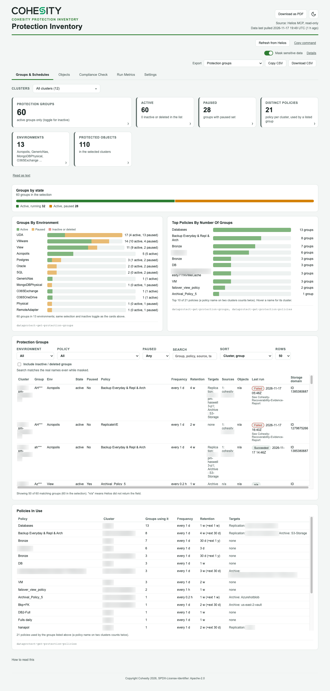
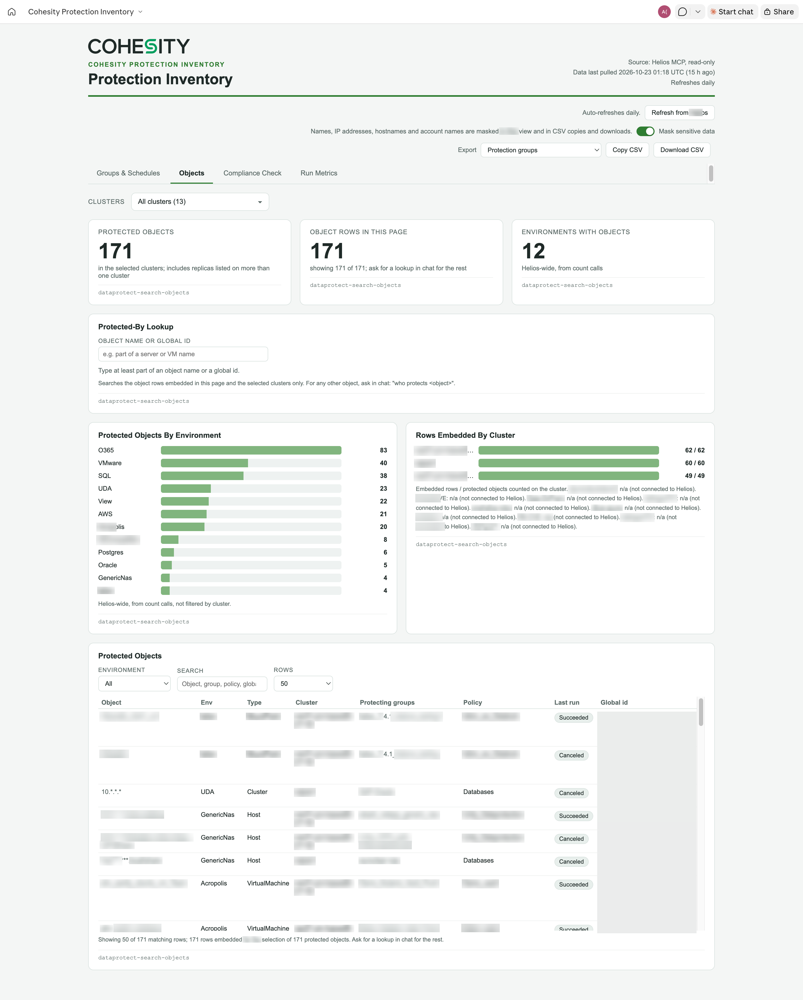
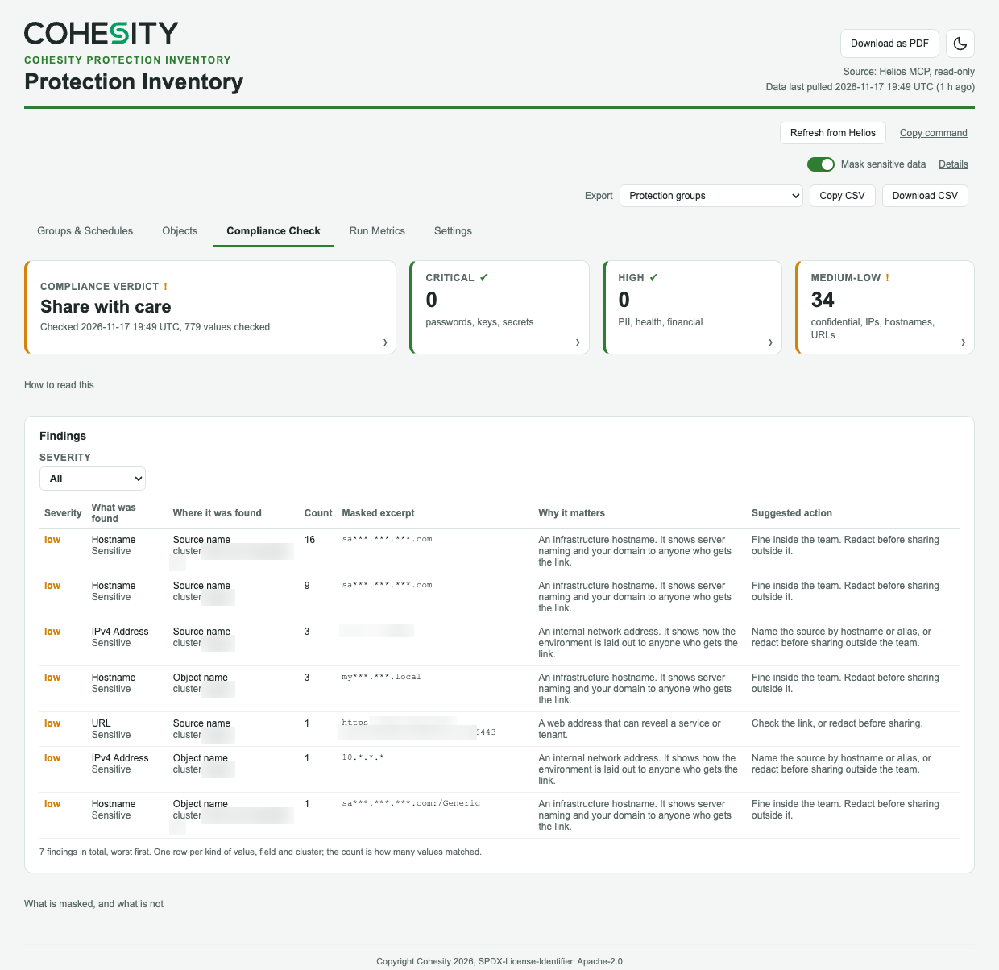
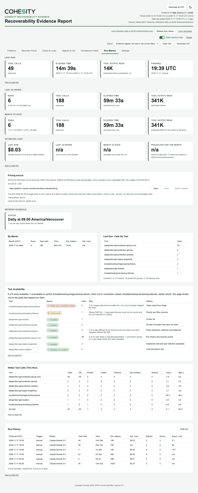

Copyright Cohesity 2026, SPDX-License-Identifier: Apache-2.0

# Protection Inventory: Claude Sample Output

Sample output of the Claude skill [`Cohesity-Protection-Inventory/SKILL.md`](Cohesity-Protection-Inventory/SKILL.md). For install and use, see the [main README](../README.md). Every page has the Cohesity logo top-left and "Data last pulled" with its age top-right. Screenshots are from the published artifact (lab data); hostnames, cluster names and other identifying values are blurred.

## Groups & Schedules

## Objects

Protected objects with their group, policy and last run.

## Compliance Check

Checks the metadata shown on the page for personal data, secrets and infrastructure details before the page is shared.

## Run Metrics

Tool calls, elapsed time, estimated tokens and estimated cost for the last run, the last 24 hours and the month to date, plus the full run history. The Run History card has an **Audit trail** button that opens a pop-up of everything the skill did on each run (every Helios call, the path decision, the schedule found, the price source, fallbacks and the publish), with filters for category (Tool call, Data pull, Error and so on), status (failed, timeout and so on) and run, a search box and a CSV download; it is read-only and masked like the rest of the page. A **Pricing source** card under the cost tiles holds the link the skill reads the price per million input tokens from (default `https://platform.claude.com/docs/en/about-claude/pricing`); editors can save a different page, CSV or Excel link (for example a negotiated rate) and reset it to the default, and the skill reads it at the start of each run. A Tool availability section lists every Helios tool the skill can use, with its status (available, partial, skipped, not available in this connection, disabled or access denied, not licensed or not entitled, timed out, error) and the reason; the other tabs show "n/a" with a note for any part that depends on an unavailable tool.

## Summary, charts, trend and PDF

The first tab starts with a hero tile and KPI tiles (with change chips and, after three or more runs, small trend lines), all clickable to the matching table or tab, a segmented bar of groups by state, a Summary kept as text behind a "Read as text" toggle, and two charts (groups by environment, top 10 policies). A Download as PDF button builds one real PDF in the browser from the data already on the page (nothing is sent anywhere): the header and summary on the first page, then a section for every report tab (never Settings), each on a new page with a header band, tables capped at 500 rows and at most 150 pages. It uses html2canvas and jsPDF loaded from cdnjs.cloudflare.com on first click and saves through the downloads capability, which asks you to confirm. While the Mask sensitive data switch is on, protection group and object names show as their first two letters plus `***` on the page, in CSV and in the PDF; cluster and policy names are shown as they are.

## Settings

The last tab is the canonical Settings block (v1.3) shared by all six Cohesity skills: a table of how the page uses your data. Its one row, "Data tools" (always on, shown as a greyed switch), lists the Helios data tools used and whether they ran in the last run; nothing is sent through Helios to an LLM. On narrow screens each row becomes a stacked card. There is no popup. Below the table, the **Refresh schedule** card shows the schedule the skill found in Claude's scheduler at its last run and lets an editor save a schedule request (frequency, day, time and **time zone**, or off) in the page database. The time zone defaults to the viewer's own zone; the skill converts the requested time to the local time of the computer running Claude (daylight saving changes can shift the local run time by one hour). Until the request is applied the card says "Not applied yet. Click Apply in Claude, then press Enter in the chat that opens." and shows the **Apply in Claude** link (a new Claude chat with the apply command typed in) and a **Copy command** button. The skill also applies the request at the start of every run, and a change made in Claude Desktop or on the web shows on the page after the next run. Asking Claude to "apply the saved schedule" runs the schedule-only mode: no Helios calls, only the scheduled task and the schedule fields of the page change. The links need the Cohesity-Protection-Inventory skill and the Helios connector in the viewer's Claude, and the buttons are disabled for viewers who are not signed in to Claude (for example public-link viewers). Scheduled runs need Claude open on that computer (scheduled tasks may be moved to the cloud later). The card needs the page database and your identity; without them it shows the status only.

The page header has ONE icon theme toggle at the top right (a sun when the page is dark, a moon when it is light). The page follows the browser or system light or dark setting and switches live when that setting changes; clicking the button flips the theme for this page view only, and the choice is not stored (it resets when the browser setting changes or the page is reloaded). The button is hidden in print. The footer reads "Copyright Cohesity 2026, SPDX-License-Identifier: Apache-2.0".

## Settings

The Settings tab is the same on every Cohesity skill page. It lists what the page reads, where the data goes, and the one switch for the optional Cohesity AI agents (off by default), plus the **Refresh schedule** card.

## Audit trail

The **Audit trail** button in the Run Metrics tab (Run History card) opens a read-only list of every Helios call and decision of each run, with filters for category, status, run and search, and a CSV download.

## How Cohesity handles data sent to its LLM

Before the Cohesity AI agents can be switched on, the page shows this notice. The questions and answers are blurred in this sample; the page shows them in full.

